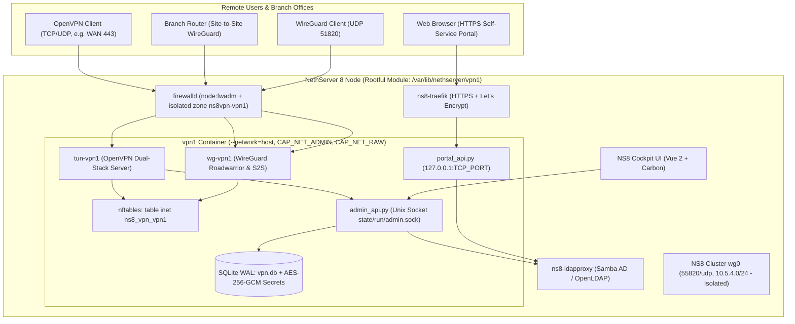

<p align="center">
  
</p>

<h1 align="center">ns8-vpn — Business Roadwarrior VPN, Self-Service Portal & Site-to-Site for NethServer 8</h1>

<p align="center">
  <a href="https://github.com/GeneraBlack/ns8-vpnportal/actions/workflows/test.yml"></a>
  <a href="https://github.com/GeneraBlack/ns8-vpnportal/actions/workflows/build-images.yml"></a>
  <a href="LICENSE"></a>
</p>

`ns8-vpn` is a standalone, production-ready **NethServer 8 (NS8)** rootful module that combines high-speed **WireGuard** roadwarrior connectivity, an **OpenVPN Dual-Stack TCP/UDP fallback server** for restrictive guest/hotel networks, **WireGuard Site-to-Site branch office tunnels**, and a **Traefik-integrated End-User Self-Service Web Portal with TOTP 2FA** — directly coupled to NS8's central user directories (**Samba Active Directory** and **OpenLDAP** via `ldapproxy`).

---

## Why `ns8-vpn`?

Small and medium-sized businesses frequently deploy NethServer 8 behind standard ISP/SOHO routers (via port forwarding) or directly on cloud VPS instances without a dedicated external firewall appliance. Standalone community VPN containers are decoupled from NS8's account providers, meaning profiles must be maintained manually and disabled Active Directory accounts keep active VPN access. In addition, UDP-only WireGuard is often blocked on hotel, clinic, trade-show, and public Wi-Fi networks.

`ns8-vpn` solves both challenges natively inside NethServer 8:
1. **Live Directory Coupling & Instant Eviction:** Synchronizes group membership and account status via NS8 `ldapproxy`. Disabling, expiring, deleting, or removing a user from the authorized VPN group immediately evicts their WireGuard peers from the kernel and terminates active OpenVPN sessions.
2. **Self-Service Onboarding:** Employees sign in to a dedicated HTTPS portal behind `ns8-traefik` using their standard NS8 credentials (protected by optional or mandatory TOTP 2FA) to create device profiles, scan mobile QR codes, download `.conf` / `.ovpn` configurations, and follow built-in step-by-step OS setup guides.
3. **Dual-Protocol Resilience:** Fast WireGuard (`UDP`) for everyday work plus OpenVPN (`TCP` — e.g. over WAN port `443`) with live directory password + TOTP verification when UDP is blocked.

---

## Key Features

### Identity, Access & Lifecycle (`ldapproxy`)
- **Native NS8 User Domain Support:** Works out-of-the-box with **Samba Active Directory (`ad`)** (including nested groups via `LDAP_MATCHING_RULE_IN_CHAIN` `1.2.840.113556.1.4.1941`, `userAccountControl` disabled bitmask `0x0002`, and Windows FILETIME `accountExpires`) and **OpenLDAP (`rfc2307`)** (`posixGroup`, `groupOfNames`, `pwdAccountLockedTime`, `shadowExpire`).
- **Immediate Kernel & Daemon Revocation:** Unauthorized accounts have active WireGuard peers removed via `wg set <iface> peer <pubkey> remove` and active OpenVPN sessions terminated via the local management socket (`kill <username>`).
- **Fail-Safe Directory Sync:** Transient LDAP/AD network timeouts never drop existing authorized VPN tunnels.

### Networking, Routing & NS8 Cluster Safety
- **Zero Collision with NS8 Cluster VPN (`wg0`):** Uses dedicated per-instance interfaces (`wg-<module_id>` on default `51820/udp`, `10.199.0.0/24` and `tun-<module_id>` on default `1194/tcp`, `10.199.1.0/24`) and actively validates against NS8's internal cluster WireGuard (`wg0`, `55820/udp`, `10.5.4.0/24`), `ns8-traefik` (`443/tcp`), host routing tables, and bound sockets.
- **Server-Side Split-Tunnel vs. Full-Tunnel Enforcement:** Atomic per-instance `nftables` rules (`table inet ns8_vpn_<module_id>`) enforce allowed destination CIDRs on the server so client-side tampering with `AllowedIPs` cannot reach unauthorized networks, `wg0`, or host-internal services (`6379/tcp` Redis).
- **PPPoE / NAT Ready:** Includes TCP MSS clamping (`1380` default client MTU for VDSL/PPPoE/LTE links) and configurable SNAT masquerading so LAN hosts behind consumer routers reply without static return routes.
- **Automatic IPAM & Optional Static Admin IPs:** Automatic `/32` pool allocation for all users, plus optional static tunnel IP assignment (`assigned_ip`) when administrators provision devices in NS8 Cockpit.

### End-User Self-Service Portal & Two-Factor Authentication
- **Privilege-Separated Listeners:** All NS8 Cockpit administrative actions communicate exclusively over a `0600` root Unix Domain Socket (`state/run/admin.sock`). The Traefik-facing HTTP listener (`127.0.0.1:${TCP_PORT}`) exposes **only** the end-user portal and never mounts `/api/v1/admin/*`.
- **Hardened Web Portal:** Strict `Content-Security-Policy` (zero external CDN calls, zero `innerHTML` sinks), `HttpOnly; SameSite=Lax` HMAC-SHA256 sessions, `X-Requested-With: NS8VPNPortal` CSRF protection, and sliding-window login rate limiting.
- **Flexible TOTP 2FA:** Configurable per instance as `disabled`, `optional` (user opt-in), or `required` (enforced enrollment wizard before any profile can be created or downloaded), including helpdesk 2FA reset in NS8 Cockpit.
- **Built-In Setup Guides:** Interactive 4-step instructions for **Windows, macOS, iOS (iPhone/iPad), Android, and Linux** in English and German.

### OpenVPN Fallback & Site-to-Site Branch Coupling
- **Three-Layer OpenVPN Security:** Combines a 2048-bit `tls-crypt` static key, mutual TLS (`ECDSA P-256` PKI generated and encrypted at rest in SQLite), and mandatory live AD/LDAP password (+ optional 6-digit TOTP suffix) verification via `--auth-user-pass-verify ... via-file`.
- **IPv6 / DS-Lite Dual-Stack Support:** Automatically detects Dual-Stack Linux hosts and binds `proto tcp6-server` / `proto udp6` (falling back to `tcp-server` / `udp` on IPv4-only hosts) so roadwarriors can connect over both IPv4 and IPv6/DS-Lite links.
- **External Router Port Mapping (`ovpn_public_port`):** Allows OpenVPN to listen on e.g. `1194/tcp` on the NS8 node (avoiding local conflict with `ns8-traefik` on `443/tcp`) while generating `.ovpn` profiles targeting external WAN port `443/tcp` forwarded by an upstream router.
- **WireGuard Site-to-Site Tunnels:** Connect branch office gateways (OPNsense, Linux routers, FritzBox LAN-to-LAN WireGuard) with automatic kernel route synchronization and ready-to-import router `.conf` export.
- **Compliance Audit Log & Restic Backup/Restore:** Bounded SQLite audit trail searchable in NS8 Cockpit with UTF-8 CSV export, plus online SQLite `.backup` snapshots (`module-dump-state`) preserving all keys, TOTP secrets, OpenVPN certificates, and peers across Restic restores and server migrations.

---

## Architecture Overview



---

## Installation

Install the module on a NethServer 8 node (e.g. node `1`) via the NS8 leader shell:

```bash
add-module ghcr.io/generablack/vpn:latest 1
```

The command returns the created module instance identifier (for example `vpn1`). Open the **NethServer 8 Cockpit UI**, navigate to **Applications → Business Roadwarrior VPN & Self-Service Portal**, and open **Settings** to complete initial setup.

---

## Quick-Start Configuration & Router Port Forwarding

1. **Directory Coupling:** Select your configured NS8 **User Domain** (Samba AD or OpenLDAP) and the **Authorized VPN Group** (e.g. `vpn-users`).
2. **Public Endpoint:** Set your public FQDN, DDNS hostname, or static WAN IP (e.g. `vpn.company.example`) and the WireGuard UDP port (default `51820`).
3. **Tunnel Mode & Internal DNS:**
   - Choose **Split-Tunnel** (routes only specified internal subnets such as `192.168.178.0/24` through the VPN) or **Full-Tunnel** (`0.0.0.0/0`).
   - Specify your internal DNS server IP (for example your NS8 Samba AD Domain Controller IP) and DNS search domain so internal hostnames and SMB shares resolve seamlessly.
4. **Self-Service Portal (Optional):** Enable the portal, enter a dedicated virtual host (e.g. `vpn-portal.company.example`), enable Let's Encrypt if publicly reachable, and select a 2FA policy (`optional`, `required`, or `disabled`).
5. **OpenVPN Fallback (Optional):** Enable OpenVPN when employees connect from restrictive guest/hotel networks that block UDP.

### Upstream Router Port Forwarding Summary

If your NethServer 8 node runs behind a NAT router, configure the following port forwards pointing to your NS8 node's LAN IP:

| Service | External WAN Port | NS8 Node Target Port | When Needed |
|---|---|---|---|
| **WireGuard VPN** | `51820/udp` *(or configured `wg_port`)* | `<NS8-LAN-IP>:51820/udp` | Always (for WireGuard roadwarrior & Site-to-Site) |
| **Self-Service Portal & Let's Encrypt** | `80/tcp`, `443/tcp` | `<NS8-LAN-IP>:80/tcp`, `443/tcp` | When exposing the Traefik Self-Service Portal publicly |
| **OpenVPN Fallback (Direct Port)** | `1194/tcp` *(or `udp`)* | `<NS8-LAN-IP>:1194/tcp` | When OpenVPN uses the same external and internal port |
| **OpenVPN Fallback over WAN TCP 443** | `443/tcp` *(on secondary WAN IP or dedicated router rule)* | `<NS8-LAN-IP>:1194/tcp` | Set `ovpn_port = 1194` and `ovpn_public_port = 443` when `ns8-traefik` does not occupy WAN `443/tcp` |

> **Note on OpenVPN + TOTP:** When *Require 2FA code on OpenVPN connect* (`ovpn_totp_required`) is enabled, users enter their current directory password immediately followed by their 6-digit Authenticator code (`<Password><6-digit-TOTP>`) in the OpenVPN password prompt.

---

## NS8 CLI Management Reference (`api-cli`)

All module capabilities can also be automated via `api-cli` on the NS8 cluster:

```bash
# Read current configuration & live connection summary
api-cli run module/vpn1/get-configuration --data '{}'

# Trigger an immediate AD/LDAP user & group synchronization
api-cli run module/vpn1/sync-users --data '{}'

# Provision a WireGuard device (with an optional static tunnel IP)
api-cli run module/vpn1/create-peer --data '{
  "username": "jdoe",
  "device_name": "Admin-Laptop",
  "assigned_ip": "10.199.0.10"
}'

# List all synchronized users and roadwarrior devices
api-cli run module/vpn1/list-peers --data '{}'

# Reset a user's TOTP 2FA secret (helpdesk recovery)
api-cli run module/vpn1/reset-user-totp --data '{"username": "jdoe"}'

# Create a Site-to-Site WireGuard branch tunnel
api-cli run module/vpn1/create-s2s-tunnel --data '{
  "name": "Branch-Munich",
  "remote_cidrs": ["192.168.20.0/24"],
  "remote_endpoint": "munich-gw.company.example:51820"
}'

# Query security and administrative audit log entries
api-cli run module/vpn1/list-audit-logs --data '{"limit": 100, "username": "jdoe"}'
```

---

## Backup, Restore & Migration

`ns8-vpn` integrates natively with NethServer 8's Restic backup engine:
- Before each backup, `imageroot/bin/module-dump-state` performs a consistent online SQLite hot backup (`state/backup/vpn.db.bak`).
- `imageroot/etc/state-include.conf` archives `state/environment`, `state/backup/vpn.db.bak`, and `state/secrets` (`master.key`).
- Restoring an instance via NS8 `restore-module` preserves the server keypair, client WireGuard peers, TOTP secrets, OpenVPN PKI certificates, and Site-to-Site tunnels so **no employee or branch router needs to reconfigure their VPN profile** after a hardware migration.
- Cloning an instance via `clone-module` intentionally generates fresh cryptographic keys and allocates non-colliding ports and transfer subnets.

---

## Building Images & Running Tests

### Build Container Images Locally

```bash
REPOBASE=ghcr.io/generablack IMAGETAG=latest ./build-images.sh
```

Builds both required images:
1. `${REPOBASE}/vpn-controller:${IMAGETAG}` (`container/Containerfile`)
2. `${REPOBASE}/vpn:${IMAGETAG}` (`Containerfile`)

### Local Test & Audit Suite

```bash
# 1. Run Python unit & integration tests (Crypto, IPAM, WireGuard, nftables, LDAP, Portal, TOTP, OpenVPN, S2S, Actions)
pytest -v

# 2. Run NS8 architectural, rootful systemd, LF line-ending & i18n key parity audit
python tests/verify_ns8_rules.py

# 3. Check Self-Service Portal JavaScript syntax
node --check container/app/portal_static/app.js

# 4. Lint and build the NS8 Cockpit UI (Vue 2 + Carbon)
cd ui && npm ci && npm run lint && npm run build
```

### Live NethServer 8 VM Smoke Test

On a dedicated **NethServer 8 (Rocky Linux 9 / Debian 12)** test VM, run as `root` to verify end-to-end image builds, `add-module`, `configure-module`, `wg-<id>` provisioning, `wg0` (`55820/udp`) isolation, `nftables` & `firewalld` rules, static-IP peer provisioning, audit logging, and `module-dump-state`:

```bash
# Run full live smoke test and remove the temporary module instance afterwards
bash tests/ns8_smoke_test.sh --cleanup

# Keep the test instance installed for manual Cockpit / Portal inspection
bash tests/ns8_smoke_test.sh --endpoint vpn.test.lan
```

---

## License

Copyright (C) 2026 GeneraBlack and contributors.

This program is free software: you can redistribute it and/or modify it under the terms of the [GNU General Public License as published by the Free Software Foundation](LICENSE), either version 3 of the License, or (at your option) any later version (`GPL-3.0-or-later`).
